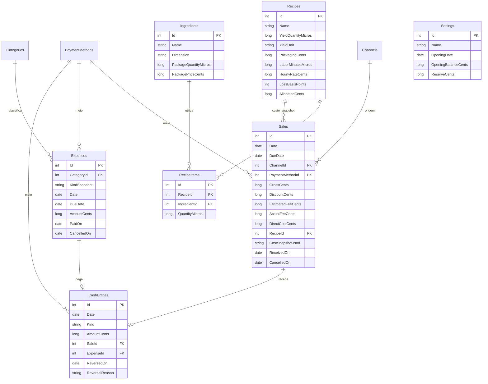

# Modelo relacional

Um negócio local. O saldo é derivado da abertura e das movimentações efetivas/estornos, sem coluna independente de saldo para ficar dessincronizada.



Custos, taxas efetivas, vínculos de receita e datas de confirmação/cancelamento são nulos quando não conhecidos/aplicáveis. `CashEntries` também registra aportes/retiradas, sem origem em venda/despesa. O valor é absoluto; sinal deriva de `Kind` e se inverte em `ReversedOn`.

Entidades possuem criação/atualização UTC. Taxas e classificações têm cópias nas operações; receita usada na venda gera JSON imutável da memória de custo. Mudanças de ingredientes não recalculam vendas passadas.

Restrições: chaves estrangeiras habilitadas, exclusões restritas, valores positivos/não negativos, descontos/taxas limitados à venda e nomes únicos nos cadastros. Índices de datas/canal/pagamento/categoria apoiam consultas. Índices únicos de movimentação por venda/despesa previnem duplicação. Confirmações usam transações; atualizações de receita e itens também são atômicas.

O aplicativo seleciona o provedor por `Database:Provider` (`Sqlite` por padrão local ou `Postgres` em produção) e usa `ConnectionStrings:Database` para a conexão. Os dois provedores têm históricos de migração distintos no mesmo assembly: `AppDbContext` usa `Data/Migrations`; `PostgresAppDbContext` usa `Data/Migrations/Postgres`. Ao criar uma alteração de esquema, gere e revise a migração para cada contexto; a aplicação só executa o conjunto do provedor configurado. Para PostgreSQL, use `dotnet ef migrations add Nome --context PostgresAppDbContext --project src/Confeitaria.Web --output-dir Data/Migrations/Postgres`; para SQLite, `dotnet ef migrations add Nome --context AppDbContext --project src/Confeitaria.Web --output-dir Data/Migrations`. Não use `EnsureCreated` no aplicativo.

### Falha de migração em produção

A aplicação valida que o contexto e o provedor são Npgsql, registra quais migrações PostgreSQL selecionou e consulta o histórico aplicado antes de migrar. Se encontrar no histórico um ID pertencente às migrações SQLite, interrompe a inicialização antes de executar outra migração. Isso evita que um deploy de correção tente criar tabelas sobre um esquema parcialmente criado; não tenta apagar, marcar ou reconciliar migrações.

Após erro de migração no Render:

1. Pause deploys/restarts automáticos do serviço e faça um backup do banco antes de qualquer alteração.
2. No SQL Editor do Supabase, consulte somente leitura o histórico e as tabelas atuais:

   ```sql
   SELECT "MigrationId"
   FROM "__EFMigrationsHistory"
   ORDER BY "MigrationId";

   SELECT table_name
   FROM information_schema.tables
   WHERE table_schema = 'public' AND table_type = 'BASE TABLE'
   ORDER BY table_name;
   ```

3. Compare a saída com os logs do Render para identificar quais operações foram concluídas. Uma migração EF pode persistir individualmente antes de uma migração posterior falhar; portanto, o esquema pode estar parcial. Não remova tabelas, não altere `__EFMigrationsHistory` manualmente e não reimplante até confirmar se há dados ou objetos que precisam ser preservados.
4. Se houver dados/objetos existentes ou o estado não estiver claro, pare e faça uma reconciliação/restauração planejada a partir do backup. Só em banco confirmado como descartável e sem dados, limpe os objetos criados pela aplicação de forma controlada após revisão; então a migração PostgreSQL inicial pode ser aplicada pelo próximo deploy.
